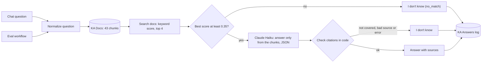
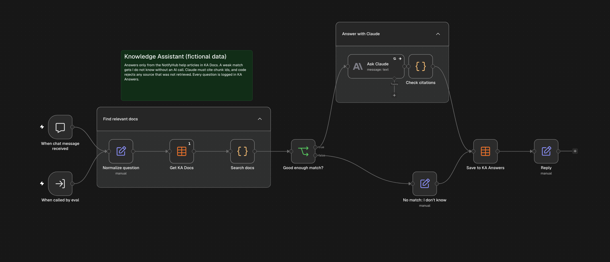

# Knowledge Assistant: documentation answers with cited sources in n8n

A portfolio project on fictional data. The assistant answers customer questions from the help articles of an invented push notification product called NotifyHub. Every answer names the article sections it came from. When the articles do not contain the answer, it replies "I don't know based on the documentation." and logs the question as a gap. No real customer or company data is used.

## Problem

Support and onboarding teams answer the same product questions every day, and the answers already exist in the help center. An AI assistant can save that time, but only if it can be trusted. A wrong answer said with confidence is worse than no answer: the customer acts on it, and the team has to clean up later. So the assistant needs three things: show where each answer comes from, refuse when the documentation is silent, and record those questions so someone can fill the gap.

## How it works

1. A question arrives from the n8n chat, or from the evaluation workflow.
2. The workflow reads 43 chunks from the `KA Docs` data table. A chunk is one section of one help article, with `chunk_id`, `doc_id`, `title`, `section` and `text`.
3. A Code node scores every chunk against the question and keeps the top 4. The score is the share of the question's important words found in the chunk, weighted by how rare each word is in the docs (inverse document frequency). 1.0 means every important word is there, 0 means none.
4. If the best score is below 0.35, the workflow answers "I don't know" straight away. The AI is not called.
5. Otherwise Claude Haiku gets the question and the 4 chunks, with instructions to use only those chunks and to return JSON: `answer`, `sources` (chunk ids) and `not_covered` (true or false).
6. A Code node checks the reply. It must be valid JSON. If `not_covered` is true, the answer is "I don't know". Every cited chunk id must be one of the 4 chunks that were actually retrieved; one unknown id and the whole answer is replaced with "I don't know".
7. Every question is saved in the `KA Answers` table with `question`, `answer`, `sources`, `retrieved_ids`, `top_score`, `status` and `channel`. Any status other than `answered` is a documentation gap.

## Why keyword search and not vector search

The n8n instance has no credentials of its own: Claude runs on n8n's built-in AI credits, and there is no vector database connected. Vector search compares the meaning of texts using embeddings, so it would also find "price" for a question about "cost". Keyword search only matches words, but it is free, gives the same result every time and is easy to explain line by line. On 14 short articles written in plain language it found the right article for all 10 answerable test questions. With a larger or messier help center, embeddings would be the next step (see Next improvements).

## Safeguards

| Safeguard | What it prevents | Where |
| --- | --- | --- |
| Score threshold (0.35) | Asking the AI when nothing relevant was found, which invites guessing | `Good enough match?` |
| Answer only from the given chunks, as JSON | Answers from the model's general knowledge | `Ask Claude` prompt |
| `not_covered` flag | A forced answer when the chunks touch the topic but do not answer it | `Ask Claude` prompt, `Check citations` |
| Citation check in code | Sources that the model made up or took from outside the retrieved chunks | `Check citations` |
| Fail closed | A failed AI call or broken JSON becomes "I don't know", never a half answer | `Check citations` |
| Question and chunk text marked as data | Instructions hidden in a question or a document changing the rules | `Ask Claude` prompt |
| Logging with status | Gaps disappearing without anyone seeing them | `Save to KA Answers` |
| Read-only tools | The workflow sends no emails or messages and calls no outside system except the AI model | whole workflow |

## Test results

`Knowledge Assistant Eval` sends 15 test questions through the real workflow and compares each reply with the expected result. 10 questions are answered in the docs and have an expected `doc_id` and a key fact. 5 are not answered in the docs. Two of those five are deliberately tricky: they share words with the docs ("limit", "automations", "notifications per day"), so they pass the threshold and test whether the AI itself refuses.

Both runs, as saved in the `KA Eval Runs` table:

| Run (Europe/Warsaw) | Questions | Retrieval hits | Correct citations | Key fact in answer | Correct refusals | False refusals | Refused by threshold | Refused by AI | Mistakes |
| --- | --- | --- | --- | --- | --- | --- | --- | --- | --- |
| 2026-11-06 21:44 | 15 | 10 of 10 | 10 of 10 | 10 of 10 | 5 of 5 | 0 | 3 | 2 | none |
| 2026-11-06 21:45 | 15 | 10 of 10 | 10 of 10 | 10 of 10 | 5 of 5 | 0 | 3 | 2 | none |

- **Retrieval hit:** the expected article is among the 4 chunks found.
- **Correct citation:** the question was answered, every cited chunk was retrieved, and at least one cited chunk belongs to the expected article.
- **Key fact:** the answer contains the expected fact, for example "15 minutes" or "49".
- **Correct refusal:** a question the docs do not cover got "I don't know". A refusal caused only by a failed AI call does not count.

A separate guard test fed the workflow a fake AI reply that cited a chunk the search had not found (`D09-2`). The citation check replaced the answer with "I don't know" and logged it as `citation_failed`.

Per-question results and the exact answers are in [`test-results.md`](test-results.md).

These are small tests on fictional data, and I wrote both the articles and the questions. The 0.35 threshold was chosen by looking at the scores of these same 15 questions. The results show that the mechanism works as designed, not how it would perform on a real help center.

## Limitations

- Built and tested on fictional data, not deployed on production systems.
- Keyword search misses synonyms and paraphrases that share no words with the docs.
- The threshold is tuned on 15 questions. A real help center needs a larger test set and a re-check of the threshold.
- The key-fact check is a text match. It shows the main fact is present, not that the whole answer is well written.
- The citation check proves that sources were retrieved, not that every sentence is supported by them. A person should still review answers before they reach customers.
- The chat has no memory, so each question is answered on its own.

## Tools

- n8n: Chat Trigger, Code, IF, Set, Execute Sub-workflow and Data Tables
- JavaScript in n8n Code nodes
- Anthropic Claude Haiku through n8n's built-in AI credits
- Claude for AI-assisted building, review and testing

## My role

I built this project with AI assistance. I defined what a trustworthy answer means here (sources, refusals, gap log), chose keyword search over vector search for this data, set the threshold rule and the citation rule, wrote the expected results for every test question and decided to replace two easy "not covered" questions with harder ones.

## What broke and what I changed

- **Rejected model setting:** the first live call failed with "Bad request" because the model does not accept a temperature setting. The workflow still answered "I don't know" and logged `ai_error`, which showed the fail-closed path works. I removed the setting.
- **A test that was too easy:** in the first draft all five "not covered" questions scored below the threshold, so the test never checked whether Claude refuses on its own. I replaced two of them with questions that share words with the docs.
- **Counting refusals honestly:** a refusal caused by an AI error now counts as a mistake, not as a correct refusal.

## Files

- [`Knowledge Assistant.json`](Knowledge%20Assistant.json): main n8n workflow export
- [`Knowledge Assistant Eval.json`](Knowledge%20Assistant%20Eval.json): evaluation workflow export
- [`notifyhub_articles.csv`](notifyhub_articles.csv): 14 fictional help articles split into 43 chunks
- [`eval_questions.csv`](eval_questions.csv): 15 test questions with the expected article and key fact
- [`test-results.md`](test-results.md): per-question results and answers from the test runs
- [`MECHANIZM_PL.md`](MECHANIZM_PL.md): study notes in Polish
- [`workflow.png`](workflow.png): n8n workflow screenshot

## How to import

1. In n8n, create four data tables:
   - `KA Docs`: `chunk_id`, `doc_id`, `title`, `section`, `text` (all text). Import `notifyhub_articles.csv`.
   - `KA Eval Questions`: `q_id`, `question`, `expected_doc_id`, `expected_keyword` (text) and `should_answer` (boolean). Import `eval_questions.csv`.
   - `KA Answers`: `question`, `answer`, `sources`, `retrieved_ids`, `status`, `channel` (text) and `top_score` (number).
   - `KA Eval Runs`: `run_at`, `mistakes` (text) and `questions`, `retrieval_hits`, `citations_correct`, `facts_found`, `correct_refusals`, `false_refusals`, `refused_by_threshold`, `refused_by_ai` (number).
2. Import both workflow JSON files.
3. In every data table node, select your own table. In `Ask Claude`, select an Anthropic credential or n8n's built-in AI credits.
4. In `Knowledge Assistant Eval`, select `Knowledge Assistant` in the `Ask Knowledge Assistant` node.
5. Open the chat in `Knowledge Assistant` to ask a question, or run `Knowledge Assistant Eval` to repeat the test.

## Next improvements

- Add vector search with embeddings next to keyword search and compare both on the same test set.
- Grow the test set to 50 or more questions, including paraphrases with no shared words.
- Send a weekly summary of `not_covered` and `no_match` questions to the documentation owner.
- Check each sentence of the answer against the cited chunk, not only the chunk ids.
